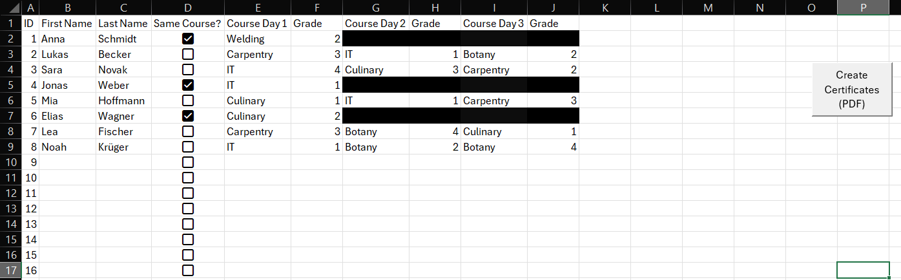
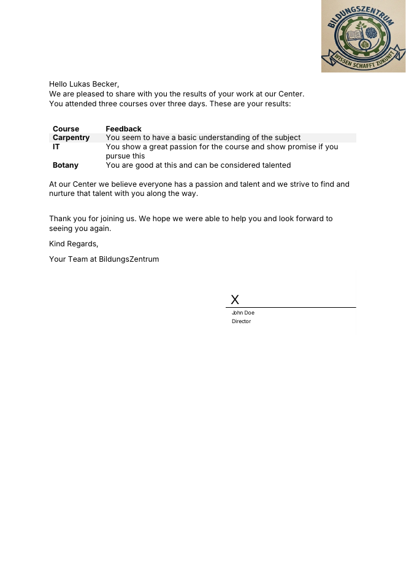

# Excel VBA Certificate Generator

> **Kurzfassung (DE):** Excel-VBA-Tool, das aus einer Teilnehmerliste per Word-Serienbrief automatisch ein PDF-Zertifikat pro Person erzeugt. Nachbau eines Tools, das ich beim BBZ Kleve entwickelt habe.

**Note:** This is a re-implementation of a tool I originally built at **BBZ Kleve** (vocational training centre). The original belongs to BBZ. This version shows how it works, using fictional test data.

---

## Problem

At the training centre, participants attend up to three courses over three days and receive a personal certificate with written feedback for each course. Before the tool, every certificate was created by hand in Word: names, courses and feedback texts were copied over one by one. This was slow and error-prone (wrong names, mixed-up grades, inconsistent wording).

## Solution

1. **Input (Sheet1):** staff enter each participant, their courses and a grade from 1 to 5.
   - Courses and grades are picked from **dropdown lists** (data validation), so there are no typos.
   - A **"Same course?" checkbox** marks participants who stay in one course for all three days. Their entries for days 2 and 3 are then ignored automatically.
2. **Merge source (Sheet2):** formulas clean up the input and turn each grade into a feedback sentence (`VLOOKUP` against the list on the `List` sheet). Empty rows are filtered out.
3. **Output (VBA + Word):** one click on **"Create Certificates (PDF)"**:
   - checks that the template exists and that participants are entered
   - runs a Word Mail Merge in the background
   - saves **one PDF per participant** (`Lastname_Firstname.pdf`) in the `Certificates` folder
   - catches errors and shows a clear message instead of crashing

## Result at BBZ

| | Before | After |
|---|---|---|
| Time per course group | [e.g. X hours of copying] | [e.g. 1 click, under a minute] |
| Errors | [e.g. regular corrections] | [e.g. none, since data is entered only once] |

## Example

🎥 [Watch the demo video](https://www.loom.com/share/d3b9eaa596bd4548b4687f23b301168c)

## Files

| File | Purpose |
|---|---|
| `CertificateGenerator.xlsm` | Workbook: input, merge source, lists, button |
| `CertificateTemplate.docx` | Word template with merge fields (`«First_Name»`, `«Course_Day_1»`, `«Grade»` …) |
| `src/CertificateGenerator.bas` | VBA code (exported module, readable without Excel) |

## How to use

1. Put `CertificateGenerator.xlsm` and `CertificateTemplate.docx` in the **same folder**. A local folder is best; OneDrive folders can cause path problems.
2. Open the workbook and enable macros.
3. Enter participants in `Sheet1`.
4. Click **Create Certificates (PDF)**. The PDFs appear in the `Certificates` subfolder.

Requires Microsoft Excel and Word (Windows).

## Techniques

- VBA with **late binding** (no Word library reference needed)
- **Word Mail Merge** controlled from Excel (`OpenDataSource` with an SQL filter, one record per run)
- **PDF export** per record (`ExportAsFixedFormat`)
- **Error handling** with clean-up (Word is always closed again)
- **Data validation** (dropdowns), checkboxes, named ranges, `IF`/`VLOOKUP` logic
- Relative paths (`ThisWorkbook.Path`), so it works on any computer

---

**Author:** Subhi Al-Sela · [LinkedIn](https://www.linkedin.com/in/subhi-al-sela-39b72a238/) · [Power BI project](https://github.com/samsela-dot/liefertermin-dq-dashboard)
